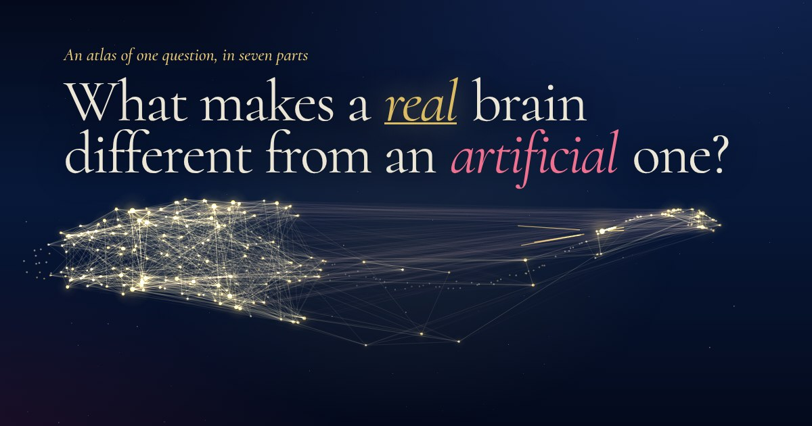

# NEMATICA

[](https://nematica.weptune.dev)

**What makes a real brain different from an artificial one?** NEMATICA puts living nervous systems and
artificial neural networks through the same tests and judges both against one yardstick: how much real
animals differ from each other. A copy passes when it sits no further from an animal than another animal
would.

**See the results at [nematica.weptune.dev](https://nematica.weptune.dev).**

## Three rules

- **The same instrument.** A recording is a brain seen through an instrument. Every network is recorded
  the way the animal was: the same number of cells, the same noise, the same blind spots.
- **The same yardstick.** Two real animals never match exactly. The spread between them is the only
  unit used.
- **Watch, then touch.** Looking like a brain at rest is one test. Answering like one when a single cell
  is switched on is another. Both are asked for, and they do not agree.

## Results so far (21 Nov 2026)

Seven questions, in worms (*C. elegans*) and mice, all on public recordings. Most tests were written down
before the data was opened, and the results that went against the project are kept.

| | Question | What we saw | Animals |
|---|---|---|---|
| I | **The Echo.** Touch one neuron: does the copy answer like a real brain? | Copies that only watched pass up to 5 of 6 tests of resting activity, then answer a poke almost at random (agreement 0.01, where one real worm agrees with another at 0.10). Copies that also learned from pokes answer like a second worm. | 113 worms |
| II | **The Push.** Can watching tell which way a cell pushes the brain? | Switching on one kind of inhibitory cell lowered activity in most regions of cortex in 29 of 29 mice. A copy fitted at rest predicted a rise. | 39 mice |
| III | **The Face.** Is a good copy still an individual, or an average? | The best forecaster is the least individual (0.78, where real worms sit at 1). Keeping each worm's own dynamics restores it (0.99) for under 0.01 of forecasting skill. | 27 worms |
| IV | **The Long Memory.** Does a brain hold the past longer than a network? | Recorded through each mouse's own instrument, a random network holds less of the past than the mouse in 33 of 35. A slow drive closes the gap. | 35 mice |
| V | **The Inner Light.** Does a brain carry more inner state than a network? | Seven kinds of network land on both sides of the mice. None of the four claims written down in advance held. | 49 mice |
| VI | **The Waning.** Ask the same thing twice: does the answer fade? | A worm neuron asked again within two minutes answers at about half. A mouse's driven cells answer later flashes at about four fifths of the first, then hold steady. A network answers the same every time. Whether the neuron tires or the light tool does cannot be separated in this data. | 37 worms, 39 mice |
| VII | **The Journey.** Does a copy of a still animal hold once it moves? | The recipe that passes on held-still worms fails on worms that move (1 to 3 of 6 tests). Given the coupling and skew it lacked, it passes 4 of 6: one short. | 57 worms |

So far, what separates these artificial networks from real brains is what they were shown and built to
carry, not that they are artificial. That is a reading of seven results in two species, not a law.

The [evidence page](https://nematica.weptune.dev/findings.html) says how far to trust each finding, and
the [research log](https://nematica.weptune.dev/log.html) tells it in order.

## Install

Python 3.10 or newer.

```sh
git clone https://github.com/Weptune/nematica
cd nematica
python -m venv .venv
source .venv/bin/activate        # Windows: .venv\Scripts\activate
pip install -e ".[dev]"
python -m pytest -q
```

## Test your own network

The brain-likeness test records your network at rest and while single units are briefly pushed, measures
eight signatures of its activity, and compares each with 113 real worm nervous systems probed the same
way. It needs no recordings: the worm reference ships as summary numbers.

```sh
python -m nematica brainlike my_rnn.npz                     # rate RNN weights
python -m nematica brainlike model.onnx                     # any recurrent model, one step (needs onnxruntime)
python -m nematica brainlike my_system.py --class System    # anything you can step and push
```

It writes a JSON file and a self-contained HTML report to `results/brainlike/`. The file formats and the
exact protocol are in [`docs/BRAINLIKE.md`](docs/BRAINLIKE.md).

To score a full copy of the worm brain against the stimulated worms (question I), download the
Randi et al. recordings below and see [`docs/BENCHMARK.md`](docs/BENCHMARK.md):

```sh
python -m nematica score examples/copies/linear_rest.py:LinearRest --quick
```

## Data

No recordings are stored in this repository, and none are redistributed. Download them into `data/raw/`
from their authors. The site and the documents carry summary numbers only.

| Recordings | Source |
|---|---|
| Worms poked one neuron at a time (Randi et al. 2023) | [osf.io/e2syt](https://osf.io/e2syt/), then `scripts/convert_pumpprobe.py` |
| Freely moving worms at a copper boundary (Baskoylu et al. 2026) | [Dryad](https://datadryad.org/dataset/doi:10.5061/dryad.w9ghx3g4v) |
| Freely moving worms (Atanas et al. 2023) | `scripts/fetch_atanas_copy.py` |
| Worm neuron positions (Skuhersky et al. 2022) | `scripts/fetch_atlas.py` |
| Mouse cortex, Allen Visual Coding Neuropixels | DANDI 000021, 000022 |
| Mouse cortex, Allen Visual Behavior Neuropixels | DANDI 000713 |
| Mouse cortex, Allen OpenScope Barcoding | DANDI 000563 |

Each study's document names the exact files, versions and exclusions it used, including the smaller
sets not listed here. If you use any of this, cite the people who recorded it.

## How the work is done

- Every test is written down and frozen before it runs. Changes after that are dated amendments.
- Each method is first run on made-up systems where the right answer is known.
- Separate reviewers check each study before it is frozen and again after the result. Their
  corrections stay in the record.
- A registered test runs once. Results that went against the project are reported as they came out.

Where to read more:

| Question | Documents |
|---|---|
| I The Echo | [`docs/BENCHMARK.md`](docs/BENCHMARK.md), [`docs/RECORD.md`](docs/RECORD.md) |
| II The Push | [`docs/OPTO_VBN.md`](docs/OPTO_VBN.md), [`docs/OPTO.md`](docs/OPTO.md), [`docs/OPTO_SIGN.md`](docs/OPTO_SIGN.md), [`docs/OPTO_SECOND.md`](docs/OPTO_SECOND.md) |
| III The Face | [`docs/RECORD.md`](docs/RECORD.md) |
| IV The Long Memory | [`docs/SLOW.md`](docs/SLOW.md), [`docs/SLOW_SUMMARY.md`](docs/SLOW_SUMMARY.md) |
| V The Inner Light | [`docs/MAP.md`](docs/MAP.md), [`docs/MAP_SUMMARY.md`](docs/MAP_SUMMARY.md), [`docs/PERSIST_SUMMARY.md`](docs/PERSIST_SUMMARY.md), [`docs/BARCODE.md`](docs/BARCODE.md) |
| VI The Waning | [`docs/OPTO_WANING.md`](docs/OPTO_WANING.md), [`docs/RECORD.md`](docs/RECORD.md) |
| VII The Journey | [`docs/JOURNEY.md`](docs/JOURNEY.md), [`docs/EMU_R.md`](docs/EMU_R.md) |
| All seven, in one place | [`docs/DIFFERENCES.md`](docs/DIFFERENCES.md) |

[`docs/RECORD.md`](docs/RECORD.md) is the full working record, oldest first. It was this README until
21 Nov 2026, so older documents that cite a section of "the README" mean a section there.

## What is in the repository

| Path | What it holds |
|---|---|
| `nematica/` | The Python package: data loaders, the measurements and their statistics, the model of the microscope, the copies under test, the brain-likeness test, the mouse studies |
| `scripts/` | Every analysis as it was run, one script per step |
| `tests/` | Unit tests |
| `docs/` | Registrations, results, reviews, the working record, figures |
| `examples/copies/` | Small example copies to score, and a template |
| `web/` | The site: plain HTML, CSS and JavaScript, no build step |
| `lab/` | A 3D replay of real worms (React and Three.js) |
| `deploy/brainlike/` | A container for running the brain-likeness test as a web service |


## Licence

Code: MIT, see [`LICENSE`](LICENSE). The recordings belong to their authors under their own licences.

NEMATICA is an open project by [Weptune](https://weptune.dev).
