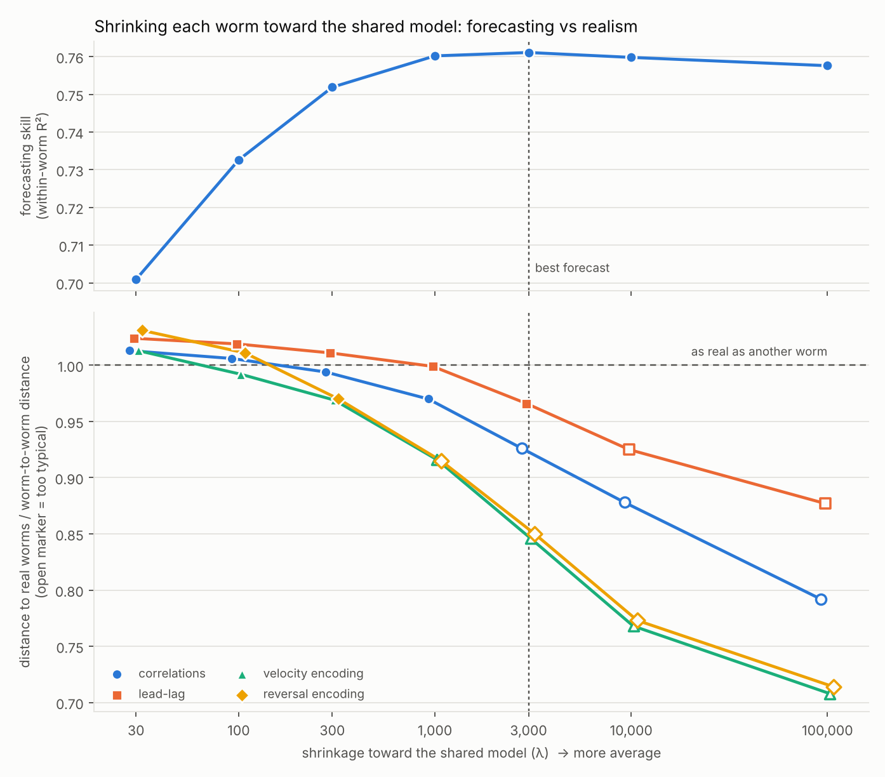
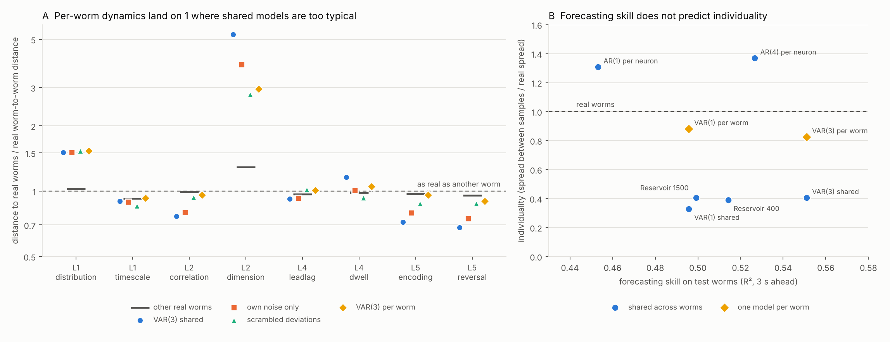

# NEMATICA

**A Turing test for artificial brains, starting with the worm.**

People are building digital nervous systems for *C. elegans* and the fruit fly, but there is
no agreed way to say whether one is right. NEMATICA is that test. It scores an artificial
worm brain against whole-brain recordings from real worms, level by level, using **how
different real worms are from each other** as the unit of measurement. A model passes a
level when it is as close to real worms as real worms are to each other: no closer, no
further.

> Real worms are weird. Fake ones are average.

The first lesson was that models trained to forecast well come out "too typical": closer
to every real worm than real worms are to each other, the average worm rather than a worm.
The current best model is a set of digital individuals (one per training worm) that is
indistinguishable from held-out real worms on all 10 pairwise levels and, for the first
time, fools a cross-validated classifier in two of three held-out worm groups.

## What is built

| Part | What it does |
|---|---|
| `nematica/data` | Loaders for Flavell-lab whole-brain recordings (copper-boundary set, Atanas 2023), NeuroPAL labels read straight from `.jld2`, worm-level frozen splits |
| `nematica/bench` | The ruler: eight pairwise metrics (Levels 1, 2, 4, 5), a population-level environment test (Level 6), a classifier two-sample test (Level 8), a worm-level bootstrap, calibration systems with designed outcomes |
| `nematica/forward` | Imaging model: turns simulated activity into what the microscope would record (calcium and indicator kinetics, frame exposure, noise, the template worm's labelled neurons) |
| `nematica/systems` | Systems under test: independent AR, joint VAR with behaviour, the Kunert 2014 connectome model (implicit-Euler integrator, validated against LSODA) |
| `lab/` | React and Three.js replay of real worms: tracked body, whole-brain activity glowing at atlas neuron positions, the copper arena |

### Levels

| Level | Metric | Question |
|---|---|---|
| 1 | `L1.distribution`, `L1.timescale` | Does each neuron class have realistic activity values and timescales? |
| 2 | `L2.correlation`, `L2.dimension` | Do the right classes move together, with realistic dimensionality? |
| 4 | `L4.leadlag`, `L4.dwell` | Who leads and who follows; how long reversal-command states last |
| 5 | `L5.encoding`, `L5.reversal` | Which classes track velocity and change during reversals |
| behaviour | `B.rev_rate`, `B.rev_duration` | How often the worm starts a reversal, and how long reversals last |
| 6 | `L6.encounter`, `L6.approach`, `L6.occupancy` | Does the brain respond like a real one when the head meets the copper boundary? Does reversing rise near it? Does the worm spend realistic time near copper? (population level) |
| 8 | `L8.discriminability` | Can a classifier, cross-validated by worm, tell 30 s windows of the system from real ones? |

Verdicts: **inside** (indistinguishable from another real worm), **outside**, or **too
typical** (significantly closer to every real worm than real worms are to each other).

## Results so far (copper set, Oct 31 2026)

**Headline numbers** (three rotating held-out pools of 9 worms unless stated; every
choice made on training and validation worms only, except where marked post hoc):

| | Pairwise levels inside | Level 8 classifier AUC (real control 0.46) | Copper arena |
|---|---|---|---|
| Baselines (joint VAR, independent AR, Kunert 2014 connectome model; frozen pool) | 0 to 2 of 8 | 0.99 to 1.00 | not modelled |
| Published: Creamer, Leifer & Pillow 2024 LDS (immobilised-worm models) | 0 to 1 of 6 | not run | not modelled |
| Per-worm calcium-drive VAR(3), hysteresis reversals | **10 of 10** | 0.82 held-out, 0.77 in-sample | not modelled |
| Same with 10 frames of memory | **10 of 10** | **0.62 held-out (not distinguishable in 2 of 3 pools), 0.50 in-sample** | not modelled |
| Closed loop v7 (3-frame brain senses copper, steers, reverses) | 9 of 10 | 0.95 (v6, frozen split) | occupancy and approach inside; 14 to 17% of time near copper (real 3.2%) |
| Closed loop v8 (10-frame brain) | 9 of 10 | not yet run | occupancy and approach inside; 11% near copper; encounter outside |
| Closed loop v9 (copper acts only through ASH and the brain) | 8 of 10 | not yet run | **all three Level 6 metrics inside**; 10.4% near copper |
| Closed loop v10 (v9 + tonic copper input) | 6 of 10 | not yet run | all three Level 6 inside; 25% near copper |
| **Closed loop v11 (copper enters only through ASH)** | **9 of 10** | 0.82 held-out, 0.79 in-sample | **all three Level 6 inside**; 13% near copper |
| Closed loop v12 (v11 with the 10-frame brain) | 9 of 10 | **0.67 held-out, 0.48 in-sample** | occupancy and approach inside, encounter outside; 19% near copper |

What these say:
1. **Forecasting is not fidelity.** The model that forecasts best is too typical; letting
   each worm keep more of its own dynamics than forecasting prefers is what makes models
   pass (arc 1).
2. **The ruler finds real errors.** Each new level (reversal statistics, arena occupancy,
   the fair classifier) caught a model that passed everything before it, and each caught
   error had a specific cause that was then fixed: flickering reversals, a data offset,
   too little memory, a missing outward drift.
3. **The remaining gaps are specific.** In the closed loop, copper reaches the reversal
   decision directly instead of through ASH, so the nociceptor's lead over the command
   neurons is halved (the one pairwise miss). The classifier's remaining giveaways in the
   one pool that still separates the model are AVA's smoothness and CEP's correlations
   with the command neurons.

Supporting facts:
- The ruler hits every designed calibration outcome at the pairwise levels (including the
  two reversal-statistics metrics, whose expectations were written before they were run)
  and 8 of 8 at Level 6. Real worms from another lab's unstimulated sessions score inside
  everywhere.
- In the copper arena, ASH (the canonical nociceptor) is the strongest responder when the
  head meets the boundary, followed by AWC. Two random halves of the worms agree on the
  pooled encounter response at r = 0.62.
- Baselines on the frozen test pool (behaviour levels not scored for systems without
  behaviour):

| System | Inside | Too typical | Outside | L8 AUC |
|---|---|---|---|---|
| joint VAR with behaviour | 2 | 3 | 3 | 0.99 |
| independent AR | 1 | 1 | 4 | 0.99 |
| Kunert 2014 connectome model | 0 | 0 | 6 | 1.00 |

## Arc 1: forecasting is not fidelity



**Tuning a model to forecast best makes it too typical.** Each training worm gets its own
linear model (VAR(3)), shrunk toward the shared model by a penalty λ. Forecasting skill
(within-worm R²) peaks at λ = 3,000. There, the simulated worms are too typical on
correlations and on velocity and reversal encoding (individuality 0.78). At λ = 300,
forecasting is only 0.009 R² lower and those levels sit on the real-worm line
(individuality 0.99). Fully shared dynamics (λ → ∞) are too typical on four levels.

Evidence is combined over three frozen, date-spread reference pools of 9 worms
(`configs/splits/copper2026_cv3.yaml`); every model is refitted on the other 18 worms of
each rotation. Nested check: choosing λ by realism on two pools and scoring it on the third
gives **7 of 8 levels inside on every held-out pool**. The one failure is the shape of
activity distributions (distance ratio about 1.5): Gaussian noise cannot make the skewed
calcium signal.



Other findings (`scripts/run_arc1.py`, `scripts/run_cv.py`; tables in `docs/figures/`):

- **Forecasting skill does not rank realism.** Models within 0.006 of each other in
  one-step R² (per-neuron AR, VAR, reservoirs of 400 and 1,500 units) range from 2 to 6 of 8
  levels outside and from 0.33 to 1.37 in individuality.
- **Shared dynamics make an average worm.** VAR(1), VAR(3) and the reservoir are too
  typical on correlations, lead-lag and behaviour encoding in all three pools. Tripling the
  reservoir changes nothing.
- **What has to vary between simulated worms is the dynamics, not the noise.** At the
  forecasting-chosen shrinkage, per-worm noise alone closes about 15% of the gap to real
  worms; per-worm dynamics close 55 to 77%; per-worm deviations of the same size with their
  structure scrambled close 40 to 91% (they fix correlations and lead-lag but not behaviour
  encoding).
- **A static warp does not fix the last level.** Running the same linear dynamics in a
  Gaussian-copula space (each neuron's own empirical distribution) brings the activity
  distribution ratio from about 1.5 to 1.06, but breaks reversal-state dwell times (1.00
  to 1.23): 6 of 8 inside instead of 7. With shared marginals the distributions become too
  typical (0.93). Skewed activity and realistic bout durations seem to need genuine state
  switching, which is the next model (`scripts/run_warp.py`, `docs/figures/warp_combined.csv`).
- **Neither does explicit state switching.** Separate forward and reverse dynamics, with
  neural activity driving the switches (`nematica/systems/switching.py`), bring the
  distribution ratio to 1.31 but make reversal bouts too typical: 6 of 8.
- **Diagnosis of the last level:** real traces have median skew 0.84 and excess kurtosis
  0.86; every linear-Gaussian model gives about 0. Detrending real worms barely changes the
  distance, so slow drift is not the cause. A stationary linear-Gaussian process is
  time-reversible, while calcium traces rise fast and decay slowly.
- **Modelling the drive instead of the trace passes all eight levels.** Each trace is
  deconvolved with a first-order calcium decay (d_t = y_t - γ y_{t-1}), the drive is
  modelled with per-worm VAR(3) (λ = 300) in per-worm normal scores, and samples are
  mapped back through the source worm's drive distribution and re-convolved
  (`CalciumStateSpace`, `scripts/run_calcium.py`). With γ = 0.5 (decay time 0.87 s) the
  model is **inside on 8 of 8 levels** combined over the three pools, skew 0.86 (real 0.84).
  γ was one of three values fixed in advance (0.5, 0.7, 0.85); choosing it on two pools and
  scoring the third gives 8/8, 7/8 and 8/8.
- **But a classifier still tells it apart (Level 8 AUC 0.94; other real worms 0.68).**
  (Update, Oct 31, measured with the fair design below: the frozen split overstates the
  gap. Its test worms are atypically unsmooth (median window lag-1 autocorrelation 0.64
  vs 0.72 for the training worms), which raises the control to 0.68. Over the three
  rotating pools the real control is at chance (0.46) and the model scores 0.82 against
  held-out worms and 0.77 against the very training worms it imitates. So the model does
  have a genuine, consistent giveaway, about 0.8 rather than 0.94.) The
  giveaway is short-timescale structure: within 30 s windows the model's lag-1
  autocorrelation is 0.755 against 0.656 in real worms (that feature alone gives AUC 0.88).
  Real worms have more power at both ends of the spectrum (33% of power in periods over
  3 minutes, against 19% in the model, plus more frame-to-frame variation). A VAR with
  1.8 s of memory cannot produce minute-scale structure.
- **For linear models, the eight levels and the classifier pull in opposite directions.**
  Real worms' slow power is not bleaching (raw brightness changes by about 1%, neurons rise
  and fall in equal numbers) but a slow brain-state shift: each neuron's slow part correlates
  about 0.63 with time, half of it one shared component. Adding 8 s and 50 s memory
  (`MultiScaleFeatures`) and a per-worm slow state (`SlowFastVAR`) lowers the Level 8 AUC
  from 0.94 to 0.84 on the frozen pool, but breaks pairwise levels: 6 of 8 inside instead
  of 8 (`scripts/run_slowfast.py`, `docs/figures/slowfast_combined.csv`). No linear model
  found so far passes both; real worms do.
- **A nonlinear model (GRU) has the same problem.** On the same drive-space state, a GRU
  trained for likelihood (`nematica/systems/gru.py`, `scripts/run_gru.py`), with size and
  stopping point chosen on validation worms only, is too typical on correlations and
  behaviour encoding and too low-dimensional: 3 of 8 inside for one shared GRU, 2 of 8 with
  an 8-number identity per worm, Level 8 AUC 0.95. Without early stopping it overfits
  badly (validation error 0.97 against 0.086). Selected for held-out likelihood (a
  forecasting criterion), a far more flexible model still produces an average worm; the
  per-worm linear model remains the most realistic one so far. Tables:
  `docs/figures/gru_combined.csv`, `gru_l8.csv`. PyTorch is optional (`pip install -e ".[gru]"`).
- **Reversal statistics catch the 8/8 model, and a decoder fixes it: 10 of 10.** Two
  behaviour metrics were added (onset rate per minute, `B.rev_rate`; bout-length
  distribution, `B.rev_duration`) after the closed-loop work showed that thresholding a
  noisy reversal channel goes unnoticed by the other levels. The calibration expectations
  were written first and all matched (frame shuffle outside, neural-only perturbations
  inside, other real worms inside). On the rotating pools the calcium model fails both
  (distance ratios 4.85 and 2.04): it reverses 8 times a minute for 1.8 s, against 2.9 times
  for 6.6 s in real worms, though the share of time reversing is about right (36% vs 31%).
  It flickers. Reading the same channel with hysteresis (start above `hi`, stop below `lo`,
  both fitted on training worms only: 0.25 and 0.75) gives 2.7 per minute and 6 s bouts, and
  the model is **inside on all 10 pairwise levels** (`Debounced`, `scripts/run_reversals.py`,
  `docs/figures/reversals_combined.csv`). The switching VAR, whose reversals are discrete
  states, already passed both (8 of 10 overall).
- A correction: on the single frozen 6-worm test pool the per-worm model looked fully
  inside on these levels; the rotating pools show that at the forecasting-chosen shrinkage
  it is still slightly too typical. The shrinkage sweep explains why.

**How Level 8 is reported from now on** (`scripts/run_l8_fair.py`,
`docs/figures/l8_fair.csv`; design written before the first run). For each of the three
rotating pools, the same classifier is run three ways: the model against held-out worms
(the usual test), the model against the very training worms it imitates (model error
alone), and real training worms against the held-out worms (individuality alone).

| | rotation 1 | rotation 2 | rotation 3 | mean |
|---|---|---|---|---|
| real control | 0.500 | 0.442 | 0.434 | 0.459 |
| calcium model, held-out | 0.904 | 0.793 | 0.758 | 0.818 |
| calcium model, in-sample | 0.712 | 0.796 | 0.800 | 0.769 |
| with heavy-tailed noise, held-out | 0.904 | 0.797 | 0.727 | 0.809 |
| with heavy-tailed noise, in-sample | 0.749 | 0.753 | 0.808 | 0.770 |

Real drive increments are heavy-tailed (excess kurtosis 1.8 in drive space); Student-t
innovations with per-worm degrees of freedom fitted to each training worm's residuals
(median 8.5; `IndividualVAR(innovations="student")`) bring the calcium-trace increment
kurtosis close to real (2.37 vs 2.73) but do not change the classifier result. The
remaining giveaway is second-order: model windows are about 0.03 smoother than their own
source worms, with too much power at 10 to 60 s periods and too little at 1 to 5 s.

**More memory closes most of the gap.** In-sample on one rotation's training worms (no
reference pools involved), VAR(3) windows are smoother than the worms they imitate
(lag-1 autocorrelation 0.747 vs 0.707; power share at 1 to 5 s periods 0.137 vs 0.162,
at 10 to 60 s 0.459 vs 0.413). Giving the drive model 6 frames of memory matches those
statistics (0.709; 0.161; 0.432) and 10 frames slightly overshoots (0.694; 0.169; 0.409).
On the rotating pools all three stay inside on all 10 pairwise levels (VAR(6) improves
the timescale ratio from 1.14 to 1.02; dimensionality ratio rises to 1.25 and 1.34, still
inside; `scripts/run_lags.py`, `docs/figures/lags_combined.csv`). The fair Level 8
(`docs/figures/l8_fair_lags.csv`):

| | in-sample | held-out (rotations 1, 2, 3) | held-out mean |
|---|---|---|---|
| real control | | 0.500, 0.442, 0.434 | 0.459 |
| VAR(3) | 0.769 | 0.904, 0.793, 0.758 (all p 0.02) | 0.818 |
| VAR(6) | 0.563 | 0.783 (p 0.02), 0.650 (p 0.02), 0.579 (p 0.23) | 0.671 |
| VAR(10) | 0.499 | 0.735 (p 0.02), 0.611 (p 0.08), 0.514 (p 0.44) | 0.620 |

**With 10 frames (6 s) of memory, a classifier can no longer tell the model from the worms
it imitates, and cannot tell it from held-out real worms in two of the three rotations**:
the first model to pass Level 8 anywhere. Honest bookkeeping: the in-sample criterion
pointed to 6 lags; 10 is ahead only on the Level 8 result, which uses the reference pools,
so "10 beats 6" is a post-hoc observation, while "longer memory than 3 frames" was chosen
without them. Rotation 1 still separates every model; its worms are not atypical (against
all other real worms AUC 0.50), and the features that give the model away there are AVA's
within-window smoothness (the model's AVA is rougher) and CEP's correlations with AIB and
AVA, which real worm groups do not differ on.

Caveats: 27 worms from one lab; the per-worm and shrinkage analyses were proposed after
the first ladder results and are tested with controls and nested selection, not
pre-registered; Level 8 (classifier) has not yet been run on the sweep.

## Setup (Windows, PowerShell)

```powershell
git clone https://github.com/Weptune/nematica
cd nematica
uv venv --python 3.12
.venv\Scripts\activate
uv pip install -e ".[dev]"
python -m pytest -q
```

## Data

Raw data is not in this repository. Download it into `data/raw/`:

- **Copper-boundary set** (Baskoylu et al. 2026, CC0):
  https://datadryad.org/dataset/doi:10.5061/dryad.w9ghx3g4v into
  `data/raw/doi_10_5061_dryad_w9ghx3g4v__v20260415/`
- **Atanas et al. 2023**: `python scripts/fetch_atanas_copy.py` (a third-party copy of the
  WormWideWeb JSON, for local development; the processed `.h5` files are on Zenodo)
- **Neuron position atlas** (Skuhersky et al. 2022): `python scripts/fetch_atlas.py`

## Running the benchmark

```powershell
$copper = "data/raw/doi_10_5061_dryad_w9ghx3g4v__v20260415"
python scripts/run_ruler.py --dataset copper --data $copper --split configs/splits/copper2026.yaml --other-data data/raw/atanas2023_wwweb
python scripts/run_ruler.py --dataset copper --data $copper --split configs/splits/copper2026.yaml --env-only
python scripts/precompute_kunert.py --amplitudes 0.5 --seeds 6     # cached connectome simulations
python scripts/run_benchmark.py --dataset copper --data $copper --split configs/splits/copper2026.yaml --amplitudes 0.5
python scripts/run_l8.py --dataset copper --data $copper --split configs/splits/copper2026.yaml
python scripts/plot_profile.py --dataset copper                     # results/bench/fidelity_copper.png
python scripts/run_arc1.py --data $copper --split configs/splits/copper2026.yaml --seeds 4 --out results/arc1_controls
python scripts/plot_arc1.py --results results                        # results/arc1/arc1.png
python scripts/run_cv.py --data $copper --folds configs/splits/copper2026_cv3.yaml
python scripts/run_shrinkage.py --data $copper --folds configs/splits/copper2026_cv3.yaml
python scripts/plot_shrinkage.py                                     # results/shrinkage/shrinkage.png
python scripts/run_calcium.py --data $copper --folds configs/splits/copper2026_cv3.yaml
python scripts/run_reversals.py --data $copper --folds configs/splits/copper2026_cv3.yaml
python scripts/fetch_creamer_lds.py
python scripts/run_published.py --data $copper --folds configs/splits/copper2026_cv3.yaml
```

## Replay lab

```powershell
python scripts/fetch_atlas.py
python scripts/export_replay.py data/raw/doi_10_5061_dryad_w9ghx3g4v__v20260415 --split configs/splits/copper2026.yaml --out lab/public/data
cd lab; npm install; npm run dev
```

## Arc 5: a worm that senses copper

`nematica/systems/closed_loop.py`, `scripts/run_closed_loop.py`. The calcium brain model
gets a copper input (fitted on training worms), reversals are discrete events whose rate
depends on copper, and a motion-matched body moves the head, whose distance to copper feeds
back into the brain. Simulated in each held-out worm's own arena over the three rotating
pools, against the identical model blind to copper.

**Version 1 failed:** model worms spent 40% of their time within 0.5 mm of copper (blind:
46%), against 3.2% for real worms. That failure exposed a gap in the ruler (encounter and
approach could not reject even the blind model in pools of 9), so `L6.occupancy` was added,
and it flagged both models. A diagnosis on one rotation then compared the simulation with
the real worms directly:

- **Real worms do not steer away frame by frame.** Turning rate at 0.6 s frames is not
  predictable from brain activity, reversal state or geometry (held-out R² about 0), and
  turning away from copper is negligible. What they do: reverse more when close to copper
  AND facing it (onset rate per frame 0.095 at under 0.3 mm facing out, 0.033 far away),
  starting 1 to 2 mm out; turn more right after a reversal (0.174 vs 0.124 rad per frame);
  and crawl at a bimodal speed (about +0.09 forward, -0.08 mm/s reversing).
- **Version 2** adds exactly those: a directional sense (proximity x facing the copper);
  a sensing distance chosen from {0.25, 0.5, 1, 2, 4} mm by held-out likelihood on
  validation worms (1, 1 and 2 mm in the three rotations: copper is felt from a distance,
  as expected for ions diffusing into agar); speed drawn per state from real speed
  quantiles while the brain sets fast and slow moments; and motion matching that knows
  when a reversal just ended and how the worm has been turning.

Results, held-out pools combined (`docs/figures/closed_loop_v2.csv`):

| | real | v2 senses copper | v2 blind |
|---|---|---|---|
| time within 0.5 mm of copper or beyond (median) | 3.2% | 19% | 69% |
| beyond the copper line | | 6% | 62% |
| L6.encounter / approach / occupancy | | inside / inside / inside | outside / inside / outside |
| pairwise levels inside | | 7 of 10 | 7 of 10 |

- The sensing model now passes Level 6 and the blind one fails it: copper input is what
  keeps the model worms in the arena. But 19% is still six times the real share; the
  population test (pools of 9) does not reject it, which says more about its power than
  about the model. Not solved yet.
- The pairwise misses have known causes: the reversal hazard is shared by all worms, so
  reversal rates are too uniform across worms (too typical, 0.75), and reversals are not
  driven by the brain, so the brain's lead-lag and reversal encoding fail.

**Version 3** gives each model worm its own reversal rates (onset and end offsets set in
open loop so it reproduces its training worm's onset rate and mean bout length, shrunk
toward the pooled values), and tries reversals driven by the command interneurons (AVA,
AVE, AIB, RIM, AVB, RIB) against reversals independent of the brain
(`--variants v3`, `docs/figures/closed_loop_v3.csv`):

| | time near copper | Level 6 | pairwise inside |
|---|---|---|---|
| own rates, reversals independent of the brain | 15.7% | inside on all 3 | 8 of 10 |
| own rates, reversals driven by command neurons | 35.9% | occupancy outside | **10 of 10** |
| own rates, blind | 66.2% | encounter, occupancy outside | 8 of 10 |

A real trade-off: when the command neurons decide when to reverse, the brain-behaviour
coupling is right (lead-lag 1.05, reversal encoding 0.95), but copper avoidance collapses.
Fitted on real worms, the hazard learns that copper raises reversals mainly by raising
command-neuron activity (its direct copper term turns slightly negative), and in the
closed loop the model's command neurons do not rise near copper the way real ones do.

**Version 4** fits the hazard in two stages: the copper effect on reversals alone first
(as observed overall), then the command neurons set the timing around it with the copper
terms held fixed [A] (`--variants v4`, `docs/figures/closed_loop_v4.csv`). Inside on all
10 pairwise levels and on Level 6 encounter and approach; time near copper 28.7%,
occupancy narrowly outside (0.967 of partitions). Better, not passing.

Why the model brain's command neurons miss copper: in the fitted brain, copper's one-step
effect on AVA, AIB and RIM is almost zero, but its steady-state effect through the brain's
own dynamics is large and positive (AVA +0.68, AIB +0.74 SD at the copper line), and part
of it flows through the brain's reversal channel (+0.34). In hazard mode that channel is
overwritten by the discrete reversal state, which cuts the path.

**Version 5** adds the brain's own one-step prediction of its reversal channel to the
hazard, so that path stays intact (`--variants v5`, `docs/figures/closed_loop_v5.csv`).
Reversal statistics become very close to real (spread of per-worm onset rates, log SD
0.15 vs 0.16; median bout 6.6 s vs 6.6 s on one rotation), but it is no better overall:
9 of 10 pairwise (lead-lag just outside, 1.05), 30.8% near copper, occupancy outside.

**What is still missing is avoidance at a distance.** Checked on the real worms:
- Not speed or exploration: simulated worms move as far per minute as real ones (median
  net displacement over 60 s 1.54 vs 1.44 mm).
- Not an aversive memory: after touching copper, real worms reverse less, not more
  (onset rate per forward frame 0.007 in the next 30 s, 0.038 after 5 minutes).
- Real worms mostly never get there: 33 of 43 thousand frames come from periods with no
  copper contact in the previous 5 minutes, with median distance to copper 2.1 mm, although
  they move far enough to reach it. Simulated worms touch copper about five times as often.
So the real avoidance acts before contact, and the reversal hazard measured near copper
(at most 2.5 times the far rate) does not explain it.

**Version 6: slow steering, and copper as a limit.** Over 20 s windows real worms facing
the copper 0.5 to 2 mm away turn away (cosine to the outward normal drops by 0.6 to 0.8
even without reversing) and end up further from it; frame by frame this is invisible.
v6 adds a steering term, turn rate = k x proximity x sin(angle to the outward normal),
with k fitted on training worms (indirect inference on simulated training worms confirms
the fitted gain reproduces the real slope, 0.019 vs 0.019 rad per frame) and its length
scale chosen on validation worms (2 mm). It also exposed a simulation artefact: model
worms that crossed the copper line had no data-driven reason to come back (the sense is
flat beyond the deepest real crossing), and 22% of simulated time was more than 1 mm past
the line (real 0.5%). Copper is now treated as impassable beyond the deepest crossing seen
in training worms (-0.85 mm): there the worm moves whichever way leads back inside [A].
Results (`--variants v6`, `docs/figures/closed_loop_v6.csv`): 10 of 10 pairwise, but time
near copper 27.3%, occupancy and encounter outside.

Every local statistic checked now matches real worms: steering slope, reversal rate,
duration and anatomy near copper (distance gained 9 s after a reversal ends +0.45 vs
+0.41 mm), escape depth. What does not match is how often model worms arrive at the edge.
Model worms also travel straighter over a minute and cover more ground; adding heading
noise calibrated on training worms did not change occupancy (`calibrate_heading`). This
is where arc 5 stands: the brain-behaviour model is complete at the pairwise levels in
closed loop, and the open problem is the arena-scale distribution of where worms go.

Further checks on one rotation (Oct 31): forward runs between reversals (median 12.6 vs
11.4 s), straightness of forward crawling over 3, 10 and 20 s (0.92/0.86/0.84 vs
0.89/0.83/0.82) and per-worm speed (now taken from the tracked plate position, per
training worm, `stage_speed=True`) all match; real worms vary their speed from minute to
minute about twice as much (coefficient of variation 0.12 vs 0.06), and neither shows
dwelling epochs. None of this moves occupancy (29%).

**A data caveat that limits this comparison.** In the copper set, the recorded distance
to the copper centre and the distance computed from the tracked plate position disagree
by -0.72 to +0.75 mm depending on the worm, and some tracked positions lie up to 1.6
times the arena radius from its centre. Measured with the tracked position, real worms
spend 9.1% of their time within 0.5 mm of copper, not 3.2%. The model (27 to 29%) is
outside both, but arena-scale statistics, including the facing directions used for
steering, are only as good as this geometry (about 0.7 mm).

**Resolved: a constant calibration offset.** Fitting candidate corrections per worm, a
single fixed shift of the tracked position, (0.613, 0.462) mm, makes it reproduce the
recorded distance to 0.023 mm rms in every worm (0.54 mm without), and the shift is the
same in all 27 worms to within 0.005 mm; a shift along the body or a different arena
centre does not fit. The loader now applies it (`COPPER_STAGE_OFFSET_MM`), so tracked
paths, the arena circle and the recorded distance agree (the replay lab already fitted
this offset worm by worm, so its copper ring was right; that fit now finds about zero). With corrected geometry v6 is still 10
of 10 pairwise, encounter and approach inside, occupancy narrowly outside (0.969), and
time near copper 33.7% (27.3% before the fix; run-to-run variation at this level is large).

**Level 8 for the closed loop** (`scripts/run_l8_closed_loop.py`, frozen split,
`docs/figures/l8_closed_loop.csv`): AUC 0.952, against 0.94 for the open-loop model and
0.68 for other real worms. Closing the loop does not change how detectable the brain
activity is; the giveaway is still the short-timescale spectrum (arc 1).

**Why real worms take so long to reach copper.** Real worms start a median 1.9 mm from
copper and take a median 393 s to first come within 0.5 mm (8 of 27 never do in 16
minutes); model worms got there in 103 s, all of them. Measuring the drift of distance to
copper over 20 s at each distance shows why: between 0.5 and 2 mm real worms drift away
from copper (+0.22, +0.17, +0.10 mm per 20 s), crossing over at about 2 mm, while v6 model
worms drift slightly toward it. The steering gain fitted to frame-by-frame turning
reproduces that turning but not this drift.

**Version 7** sets the steering gain by indirect inference on a different training-worm
statistic, the outward drift between 0.5 and 2 mm, instead of the turning slope (it needs
about 4 times the fitted gain, so the real drift involves more than the body turning that
can be measured) (`--variants v7`, `docs/figures/closed_loop_v7.csv`). Time near copper
15.3% (v6: 27 to 34%; real 3.2%, or 9.1% by the uncorrected tracked position), **occupancy
inside**, approach inside, encounter just outside (0.962), pairwise 9 of 10 (lead-lag
1.06, just over the line). Closest so far; not yet a full pass.
Over three independent replicates (`--seed-offset 10`, `20`): time near copper 15.3%,
13.6%, 17.2%; occupancy and approach inside every time; encounter outside, outside,
inside (0.962, 0.974, 0.936: borderline); lead-lag outside every time (1.05 to 1.06: a
small but consistent miss).

**Version 8** gives the closed-loop worm the 10-frame brain that passes Level 8 open loop
(`--variants v8`, `docs/figures/closed_loop_v8.csv`): time near copper 11.2% (best so
far), occupancy and approach inside, but encounter now clearly outside (1.0) and lead-lag
still 1.06 (9 of 10).

**What the lead-lag miss is.** Averaged over worms, the closed loop reproduces who leads
whom almost exactly (pattern correlation with real 0.96 at 1.8 and 6 s lags). The pairs
that go wrong all involve ASH, the copper-sensing nociceptor: in real worms ASH leads the
reversal command neurons by seconds (antisymmetric lagged correlation at 6 s: RIM -0.144,
AVE -0.165, AVA -0.167), and in the closed loop that lead is roughly halved (-0.054,
-0.074, -0.104). The reason is the design of v4 to v8: copper raises the reversal rate
through a direct copper term in the hazard, not through ASH. The encounter miss (the
brain's response when the head meets copper) points the same way.

**In real worms, ASH carries copper's effect on reversing.** On forward frames, ASH activity
(drive units) is +1.12 within 0.5 mm of copper against -0.25 beyond 2 mm. Predicting
reversal onsets in held-out worms (two-fold by worm), adding ASH to the command neurons
improves the log likelihood from -3094.5 to -3025.1, and adding direct copper terms on top
of ASH adds nothing (-3026.2) [M].

**Version 9** follows that: the reversal hazard uses the command neurons and ASH with no
direct copper term, so copper can act only through the brain, and the brain's copper
weights may be left unpenalised if validation worms prefer it (they did, in all three
rotations) (`--variants v9`, `docs/figures/closed_loop_v9.csv`):
- **All three Level 6 metrics inside for the first time** (encounter 0.865, approach,
  occupancy), and the lowest time near copper so far, 10.4% (real 3.2%).
- But 8 of 10 pairwise: lead-lag got worse (1.09; the expectation that it would recover
  was wrong) and the activity distribution now misses narrowly (1.06), plausibly from the
  unpenalised copper weights. The steering gain needed rose (6 to 12 times the fitted one).
- Why lead-lag does not recover: the model's ASH learned a phasic copper response (weight
  2.4 on the change in proximity, 0.04 on proximity itself). Driven by real recorded
  copper input it rises by about 0.48 near copper, a third of the real rise (1.37); in
  closed loop, where model worms near copper are rarely approaching it, the rise vanishes
  (-0.11). Real ASH also stays up while the worm is near copper; the model's does not.

**Version 10: a tonic copper input, and a check on v9's distribution miss**
(`--variants v10`, `docs/figures/closed_loop_v10.csv`). Adding proximity smoothed over a
time constant chosen on validation worms (30 s in two rotations, 15 s in one) raises the
model's ASH response to recorded copper from a rise of 0.61 to 0.90 (real 1.37), but in
closed loop it costs the brain's statistics: 6 of 10 pairwise (distribution,
correlation, lead-lag 1.14 and encoding 1.23 outside) and 25% of time near copper. Keeping
v9 but penalising the copper weights like the rest brings the distribution back inside
(1.05; so that miss did come from the unpenalised weights): 9 of 10 (lead-lag 1.06),
occupancy and approach inside, encounter outside, 11.1% near copper.

The pattern across v7 to v10: every way of making the linear brain respond to copper as
strongly and as persistently as real ASH does disturbs its other statistics, and every way
of keeping those statistics leaves ASH's response, and with it the encounter response and
ASH's lead over the command neurons, too weak. No closed-loop variant passes everything:
v9 passes all of Level 6 at 8 of 10 pairwise; v7, v8 and v9 with penalised weights are 9
of 10 with two of three Level 6 metrics. This looks like a limit of linear dynamics with
additive sensory input, a concrete target for a nonlinear sensory stage.

**Version 11: copper enters the brain only through ASH** (`--variants v11`,
`docs/figures/closed_loop_v11.csv`). The brain's copper weights (fast, change and tonic
inputs) are constrained to ASH's row; every other neuron feels copper only through the
brain's own dynamics [A: sensory neurons receive the stimulus], and reversals come from
the command neurons and ASH with no direct copper term. Driven by real recorded copper,
the model's ASH now rises by 1.11 near copper (real 1.37; v9 0.61, v10 0.90). Over the
three pools: **9 of 10 pairwise and all three Level 6 metrics inside** (encounter 0.943,
approach, occupancy), 13.0% of time near copper: the best combined result so far. The
one miss is still lead-lag (1.08), now for the opposite reason: in closed loop the
command neurons lead ASH (antisymmetric correlation at 6 s, AVE to ASH +0.138 against real
-0.165), plausibly because reversals near copper back the worm off and the next approach
raises ASH again, so ASH follows the commands instead of preceding them. Pattern
correlation with real lead-lag falls to 0.77 (v7: 0.96).

**Timing around events shows the actual cause** (all pools, activity aligned to events):

| | ASH peak (rise) | AVA peak (rise) |
|---|---|---|
| encounter (head first within 1 mm), real | +5.4 s (+0.69) | +11.4 s (+0.10) |
| encounter, v11 | +12.0 s (+0.43) | no rise |
| reversal onset within 1 mm of copper, real | +0.6 s (+0.03) | +6.6 s (+0.62) |
| reversal onset within 1 mm of copper, v11 | +11.4 s (+0.17) | +6.6 s (+0.41) |

Real ASH responds within seconds of meeting copper and is already up when a reversal
starts; the model's ASH responds too slowly (its copper input is dominated by the 30 s
tonic term validation chose), peaking seconds after the reversal. So the remaining
lead-lag miss is the speed of the sensory response, not the re-approach guessed above.

**Version 12** (v11 with the 10-frame brain; `docs/figures/closed_loop_v12.csv`): 9 of 10
(lead-lag 1.07), encounter back outside (0.974), 18.7% near copper: worse than v11 on
Level 6. **Fair Level 8 for the closed loop** (`docs/figures/l8_fair_cl11.csv`,
`l8_fair_cl12.csv`; `run_l8_fair.py --models cl11,cl12`): v11 0.816 held-out, 0.787
in-sample; v12 0.665 held-out (0.759, 0.648, 0.587; p 0.02, 0.03, 0.21) and 0.480
in-sample. With the 10-frame brain, a classifier cannot tell the closed-loop worm's brain
from the worms it imitates, while it moves in its own arena and senses copper.


## Leaderboard: published models

`nematica/systems/published.py`, `scripts/fetch_creamer_lds.py`, `scripts/run_published.py`.
First entry: the three linear dynamical systems of Creamer, Leifer & Pillow (2024,
bioRxiv 10.1101/2024.09.22.614271, MIT licence), fitted to the Randi et al. (2023)
optogenetic atlas: weights restricted to the connectome, unrestricted, or restricted to a
shuffled connectome. Their trained parameters are read from the authors' pickles as plain
data (`nematica/data/safe_pickle.py`: none of their code is imported or run), and the models
are run with stimulation off to produce spontaneous activity. They make no behaviour, so the
behaviour levels are not scored. Rotating pools (`docs/figures/published_combined.csv`):

| Model | Inside (of 6) | Correlation | Dimension | Timescale |
|---|---|---|---|---|
| connectome-constrained | 0 | 1.43 | 2.92 | 1.56 |
| fully connected | 1 | 1.46 | 1.24 (inside) | 1.51 |
| shuffled connectome | 0 | 1.56 | 4.04 | 1.62 |

(numbers are distance ratios: 1 = as far as another real worm)

- **Not a fair test yet, and the caveat is the point:** these models describe immobilised
  worms, and the reference worms here crawl freely. A model of a still brain is far from a
  crawling one, as it should be. The comparison that matters for arc 3 (what the wiring
  buys) is against immobilised reference worms; the Randi recordings are on OSF, which
  neither this workspace nor the lab machine can reach yet.
- Within that caveat, the wiring helps on what it should: the real connectome beats the
  shuffled one on correlations (1.43 vs 1.56) and much more on dimensionality (2.92 vs
  4.04). The unconstrained model has the most realistic dimensionality.
- c302 (OpenWorm) is not scored yet.

## "Which one is real?" (prototype)

Two worms crawl side by side on agar. One is a held-out real worm (body, path and brain
as recorded). The other's brain activity, speed and reversals come from the most realistic
model so far; its body shapes and steering are motion-matched from real training worms
(`nematica/export/virtual_worm.py`), so the brain decides how fast and which way it goes.
Under each worm, rolling traces of the command neurons (AVA, AVE, AIB, RIM, RIB …) and the
reversal state show whether brain and behaviour line up the way they do in real worms.
Guess, then see the model's scorecard. Neither worm shows the copper ring: the model
cannot sense copper yet.

```powershell
python scripts/fetch_atlas.py
python scripts/export_virtual_worms.py --data data/raw/doi_10_5061_dryad_w9ghx3g4v__v20260415 --split configs/splits/copper2026.yaml
cd lab; npm install; npm run dev        # then open http://localhost:5173/?mode=which
```

The answer for each round is in the round index, so this is a demo, not yet a fair test of
human viewers.


**Copper version** (`python scripts/export_virtual_worms.py --closed-loop ...`, then open
the lab at `?mode=which&set=which3`): the model worm is the v11 closed-loop worm, simulated
in the real worm's own copper arena (same radius, same starting distance), and both worms
are shown inside their copper rings. Its brain senses the copper and decides when to
reverse and where to steer; only body shapes are borrowed. The reveal shows the v11
scorecard (9 of 10 pairwise; all three Level 6 metrics inside).

## Rules that keep the benchmark honest

- `trace_array` in the Flavell files is z-scored over the whole recording, which leaks the
  future into the past; NEMATICA loads `trace_original` / `trace_array_original`.
- Splits are by worm, made once, frozen with a hash and never regenerated after results
  are seen.
- A system is never compared with the worm it was derived from.
- Every ruler change is checked against calibration systems whose answers were written
  down before running.
- Every quantity carries a provenance tag: **M** measured, **I** inferred, **L** learned,
  **A** assumed.

## Sources and licences

- Copper-boundary whole-brain recordings: Baskoylu et al. 2026, Dryad
  10.5061/dryad.w9ghx3g4v (CC0).
- Atanas et al. 2023, *Cell*: brain-wide representations of behavior (Flavell lab).
- Kunert, Shlizerman, Kutz 2014 connectome model; matrices from the C. elegans Neural
  Interactome (BSD 3-Clause, `data_assets/kunert2014/LICENSE`).
- Skuhersky et al. 2022 neuron atlas (paper CC BY 4.0), downloaded by script, not
  redistributed.
- Creamer, Leifer & Pillow 2024 trained models (MIT licence, Copyright (c) 2026 Matthew S.
  Creamer), downloaded by `scripts/fetch_creamer_lds.py`, not redistributed.
